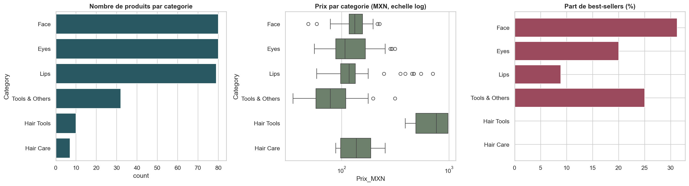

# Scraping et analyse de produits cosmétiques

Ce projet collecte automatiquement les fiches produits d'un site de cosmétiques (Selenium), puis analyse les **288 produits** obtenus :
- ce qui explique le prix ;
- si l'on peut reconnaître un best-seller ;
- quels groupes de produits se dégagent.



## Résultats

- **Prix** : la catégorie, la sous-catégorie et le contenu de la fiche (ingrédients, labels) expliquent environ **43 % de la variance** du logarithme du prix. L'erreur moyenne est de 47 pesos contre 62 pour un prix médian unique. Une régression Ridge fait aussi bien que la forêt aléatoire et le gradient boosting.
- **Best-sellers** : le signal est faible. La meilleure AUC (forêt aléatoire) est de **0,65 ± 0,08**, et la PR-AUC de 0,40 contre 0,21 pour un tri au hasard. Le fait d'avoir déjà une note compte davantage que la composition : 23 % de best-sellers parmi les produits notés, contre 12 % parmi les autres.
- **Segmentation (K-Means)** : le nombre de groupes est choisi avec le score de silhouette et testé en stabilité sur 30 rééchantillonnages. Aucun regroupement n'est stable au-delà de la séparation entre produits avec et sans labels : la gamme est homogène.
- Tous les scores sont obtenus par **validation croisée imbriquée répétée** : 5 plis × 3 répétitions, avec réglage des hyperparamètres dans une boucle interne. Chaque modèle est comparé à une référence simple.

## Structure

```
src/scraper.py          collecte automatisée (ligne de commande)
notebooks/analyse.ipynb nettoyage, exploration, modèles, segmentation
figures/                graphiques produits par le notebook
```

## Utilisation

```bash
pip install -r requirements.txt
python src/scraper.py --headless                 # collecte complète -> data/raw/produits_AAAA-MM-JJ.csv
python src/scraper.py --categories Face --max-products 5   # essai rapide
jupyter nbconvert --to notebook --execute --inplace notebooks/analyse.ipynb
```

Le scraper :
- ouvre chaque catégorie et affiche tous les produits ;
- visite chaque fiche pour relever les avis visibles, les images, les ingrédients et les labels ;
- marque les best-sellers.

Il laisse une pause entre deux pages, relance une page qui ne répond pas, et une erreur sur un produit n'arrête pas la collecte. Tout est journalisé dans `data/raw/scraping.log`.

**Limites** : les sélecteurs CSS dépendent de la structure du site et doivent être mis à jour si elle change. Seule la première page d'avis est accessible : elle ne montre presque que des 5 étoiles, donc la note des avis visibles n'est pas utilisée. Les prix sont en pesos mexicains, la devise affichée lors de la collecte.

Les données collectées ne sont pas publiées.

Technologies : Python, Selenium, BeautifulSoup, pandas, scikit-learn.
